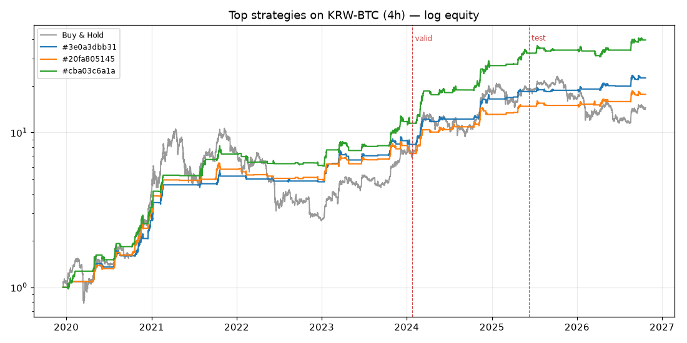

# 🤖 코인 전략 연구 리포트

마지막 업데이트: **2026-10-18** · 대상: KRW-BTC, KRW-ETH, KRW-XRP, KRW-SOL · 봉: 4h

## 🎓 졸업 심사

전당에 오른 뒤 **실제로 새로 쌓인 시세**로 매기는 시험이에요. 기준: 전진 60일 이상 · 그 기간에 +10% 넘는 상승장 포함 · 실제 거래 10회 이상(4코인 합) · 같은 기간 단순 보유보다 나은 수익 · 코인별 최대 낙폭 -20% 이내 · 튼튼함 심사 통과.

**졸업한 전략: 아직 없음**

졸업에 가장 가까운 전략:

| ID | 전진 기간 | 상승장 경험 | 실제 거래 | 보유 대비 | 최대 낙폭 | 튼튼함 | 통과 |
|---|---|---|---|---|---|---|---|
| `20fa805145` | ⬜ 10일 | ⬜ 4% | ⬜ 0회 | ✅ +8.3%p | ✅ 0% | ✅ 통과 | 3/6 |
| `f7e00c6fe8` | ⬜ 10일 | ⬜ 4% | ⬜ 0회 | ✅ +8.3%p | ✅ 0% | ✅ 통과 | 3/6 |
| `f00b4a37e3` | ⬜ 10일 | ⬜ 4% | ⬜ 0회 | ✅ +8.3%p | ✅ 0% | ✅ 통과 | 3/6 |
| `2439726ead` | ⬜ 10일 | ⬜ 4% | ⬜ 0회 | ✅ +8.0%p | ✅ 0% | ✅ 통과 | 3/6 |
| `cdcac84052` | ⬜ 10일 | ⬜ 4% | ⬜ 1회 | ✅ +6.6%p | ✅ 0% | ✅ 통과 | 3/6 |
| `b12dd3fbc7` | ⬜ 10일 | ⬜ 4% | ⬜ 0회 | ✅ +6.6%p | ✅ 0% | ✅ 통과 | 3/6 |
| `ae82267119` | ⬜ 9일 | ⬜ 3% | ⬜ 0회 | ✅ +4.9%p | ✅ 0% | ✅ 통과 | 3/6 |
| `cba03c6a1a` | ⬜ 9일 | ⬜ 3% | ⬜ 1회 | ✅ +6.1%p | ✅ 0% | ✅ 통과 | 3/6 |

## 📡 지금 보유 신호

전당 전략 42개 중 현재 코인을 들고 있는 전략: **없음 (모든 전략 관망 중)**

## 오늘
- 데이터: KRW-BTC, KRW-ETH, KRW-XRP, KRW-SOL · 4h · 마지막 봉 2026-10-17 20:00 UTC
- 기존 전략 튼튼함 소급 심사: 42개 중 36개 통과
- 1752세대 진화, 전략 87,608개 평가
- 튼튼함 심사: 0개 시도 → 0개 통과
- 새로 명예의 전당 입성: 0개 (오늘 누적 3/3, 검증 구간 B&H 샤프 1.21)

## 명예의 전당

| # | ID | 발견일 | 학습 샤프 | 검증 샤프 | 시험 샤프 | 시험 CAGR | 시험 MDD | 전진 수익 / 같은 기간 보유 | 지금 | 전략 |
|---|---|---|---|---|---|---|---|---|---|---|
| 1 | `3e0a3dbb31` | 2026-10-11 | 2.07 | 2.40 | 0.94 | +13.9% | -16.1% | 관망 +0.0% / 보유 -5.8% (7일) | 관망 | 진입: volume_spike(n=26, mult=3.63) AND momentum_pos(n=17, th=0.01) | 청산: price_below_ma(n=57, kind=sma) OR ma_cross_down(fast=5, slow=109, kind=sma) OR price_below_ma(n=135, kind=ema) | 익절 30.7% |
| 2 | `20fa805145` | 2026-10-08 | 1.84 | 2.30 | 0.94 | +14.9% | -18.9% | 관망 +0.0% / 보유 -8.3% (10일) | 관망 | 진입: macd_pos(f=16, s=21, sig=7) AND volume_spike(n=37, mult=3.51) | 청산: price_below_ma(n=55, kind=sma) OR ma_cross_down(fast=8, slow=102, kind=sma) | 익절 27.3% |
| 3 | `cba03c6a1a` | 2026-10-09 | 1.71 | 2.49 | 0.82 | +15.4% | -19.4% | +0.1% / 보유 -6.0% (9일) | 관망 | 진입: macd_pos(f=16, s=21, sig=7) AND volume_spike(n=32, mult=3.51) | 청산: ma_cross_down(fast=8, slow=102, kind=sma) | 익절 27.3% |
| 4 | `f7e00c6fe8` | 2026-10-08 | 1.87 | 2.10 | 1.21 | +22.1% | -22.0% | 관망 +0.0% / 보유 -8.3% (10일) | 관망 | 진입: donchian_break(n=71) AND price_above_ma(n=197, kind=sma) | 청산: price_below_ma(n=22, kind=ema) | 손절 19.1% / 익절 27.3% / 트레일링 24.5% |
| 5 | `114ad67d25` | 2026-10-11 | 1.96 | 2.25 | 0.54 | +11.0% | -27.4% | 관망 +0.0% / 보유 -5.8% (7일) | 관망 | 진입: volume_spike(n=20, mult=3.069) AND momentum_pos(n=17, th=0.01) | 청산: price_below_ma(n=142, kind=sma) OR ma_cross_down(fast=5, slow=109, kind=sma) OR price_below_ma(n=135, kind=ema) | 손절 20.4% / 익절 29.1% |
| 6 | `f00b4a37e3` | 2026-10-08 | 1.99 | 1.96 | 0.65 | +12.8% | -29.2% | 관망 +0.0% / 보유 -8.3% (10일) | 관망 | 진입: donchian_break(n=66) AND price_above_ma(n=197, kind=sma) AND volume_spike(n=44, mult=1.334) | 청산: price_below_ma(n=55, kind=sma) OR ma_cross_down(fast=8, slow=102, kind=sma) | 익절 27.3% |
| 7 | `d7fb6c9904` | 2026-10-11 | 1.91 | 2.28 | 0.44 | +6.5% | -27.9% | 관망 +0.0% / 보유 -5.8% (7일) | 관망 | 진입: volume_spike(n=15, mult=2.369) AND momentum_pos(n=17, th=0.01) | 청산: price_below_ma(n=57, kind=sma) OR ma_cross_down(fast=5, slow=109, kind=sma) OR price_below_ma(n=135, kind=ema) | 익절 41.1% |
| 8 | `cdcac84052` | 2026-10-09 | 1.70 | 2.38 | 0.50 | +10.9% | -21.9% | +0.0% / 보유 -6.6% (10일) | 관망 | 진입: price_above_ma(n=26, kind=ema) AND volume_spike(n=28, mult=2.52) | 청산: price_below_ma(n=55, kind=sma) OR ma_cross_down(fast=8, slow=99, kind=sma) | 손절 14.3% / 익절 27.3% / 트레일링 21.4% |
| 9 | `2439726ead` | 2026-10-08 | 1.68 | 2.16 | 0.64 | +13.6% | -23.7% | 관망 +0.0% / 보유 -8.0% (10일) | 관망 | 진입: donchian_break(n=12) AND volume_spike(n=24, mult=2.89) | 청산: price_below_ma(n=116, kind=sma) |
| 10 | `6335aeebf2` | 2026-10-10 | 2.01 | 2.07 | 0.59 | +11.2% | -23.9% | 관망 +0.0% / 보유 -5.5% (8일) | 관망 | 진입: volume_spike(n=15, mult=3.025) AND momentum_pos(n=17, th=0.01) | 청산: price_below_ma(n=57, kind=sma) OR ma_cross_down(fast=5, slow=109, kind=sma) OR price_below_ma(n=135, kind=ema) |
| 11 | `030e70f004` | 2026-10-10 | 2.07 | 1.98 | 0.15 | +1.1% | -20.4% | 관망 +0.0% / 보유 -5.5% (8일) | 관망 | 진입: volume_spike(n=15, mult=3.025) AND momentum_pos(n=17, th=0.01) | 청산: price_below_ma(n=57, kind=sma) OR ma_cross_down(fast=47, slow=239, kind=sma) OR donchian_low_break(n=46) | 익절 29.1% |
| 12 | `ae82267119` | 2026-10-09 | 1.72 | 2.36 | 0.72 | +11.1% | -17.9% | 관망 +0.0% / 보유 -4.9% (9일) | 관망 | 진입: price_above_ma(n=169, kind=ema) AND volume_spike(n=35, mult=3.62) | 청산: price_below_ma(n=56, kind=sma) | 익절 38.6% |
| 13 | `fd1c453679` | 2026-10-10 | 1.98 | 2.08 | 0.60 | +12.2% | -24.8% | +0.1% / 보유 -4.9% (8일) | 관망 | 진입: volume_spike(n=20, mult=1.54) AND volume_spike(n=15, mult=2.715) AND price_above_ma(n=16, kind=sma) | 청산: price_below_ma(n=55, kind=sma) OR ma_cross_down(fast=8, slow=78, kind=sma) | 익절 27.3% |
| 14 | `4f7cd897f0` | 2026-10-10 | 2.20 | 1.81 | 0.75 | +13.8% | -23.9% | 관망 +0.0% / 보유 -5.5% (8일) | 관망 | 진입: volume_spike(n=15, mult=3.025) AND momentum_pos(n=17, th=0.01) | 청산: price_below_ma(n=57, kind=sma) OR ma_cross_down(fast=5, slow=109, kind=sma) OR price_below_ma(n=135, kind=ema) | 손절 20.4% / 익절 29.1% |
| 15 | `7ba6000391` | 2026-10-09 | 1.75 | 2.17 | 0.77 | +16.2% | -15.6% | 관망 +0.0% / 보유 -6.0% (9일) | 관망 | 진입: donchian_break(n=26) | 청산: price_below_ma(n=15, kind=sma) OR ma_cross_down(fast=8, slow=102, kind=sma) | 익절 27.1% / 트레일링 21.4% |
| 16 | `88b03c3bd9` | 2026-10-09 | 1.78 | 2.10 | 0.11 | +0.5% | -23.4% | -0.3% / 보유 -6.0% (9일) | 관망 | 진입: low_volatility(n=43, q=0.24) AND donchian_break(n=16) | 청산: price_below_ma(n=39, kind=ema) | 손절 12.0% / 익절 27.3% |
| 17 | `ed518e2f80` | 2026-10-11 | 2.01 | 1.81 | 0.56 | +10.1% | -22.1% | 관망 +0.0% / 보유 -5.8% (7일) | 관망 | 진입: volume_spike(n=12, mult=3.069) AND momentum_pos(n=17, th=0.01) | 청산: ma_cross_down(fast=5, slow=108, kind=sma) OR price_below_ma(n=135, kind=ema) | 손절 20.4% / 익절 29.1% |
| 18 | `6f3685817a` | 2026-10-10 | 2.04 | 1.80 | 0.67 | +11.5% | -16.9% | 관망 +0.0% / 보유 -5.5% (8일) | 관망 | 진입: volume_spike(n=15, mult=3.025) AND momentum_pos(n=17, th=0.01) AND ma_cross_up(fast=13, slow=154, kind=sma) | 청산: price_below_ma(n=57, kind=sma) OR ma_cross_down(fast=5, slow=109, kind=sma) OR price_below_ma(n=135, kind=ema) | 익절 30.7% |
| 19 | `08a39b7267` | 2026-10-10 | 1.92 | 1.95 | 0.64 | +8.6% | -21.2% | 관망 +0.0% / 보유 -4.9% (8일) | 관망 | 진입: macd_pos(f=14, s=21, sig=7) AND volume_spike(n=29, mult=3.51) | 청산: price_below_ma(n=51, kind=sma) | 익절 60.8% |
| 20 | `b12dd3fbc7` | 2026-10-09 | 1.70 | 1.99 | 0.65 | +11.8% | -30.1% | 관망 +0.0% / 보유 -6.6% (10일) | 관망 | 진입: donchian_break(n=52) | 청산: price_below_ma(n=42, kind=sma) OR donchian_low_break(n=53) | 익절 33.6% |
| 21 | `5ade91c3ae` | 2026-10-13 | 1.76 | 1.84 | 1.47 | +30.2% | -12.1% | 관망 +0.0% / 보유 -4.3% (5일) | 관망 | 진입: volume_spike(n=34, mult=3.53) AND donchian_break(n=83) | 청산: price_below_ma(n=139, kind=ema) OR donchian_low_break(n=18) | 손절 9.5% / 익절 32.2% |
| 22 | `0159cf6bdc` | 2026-10-15 | 1.63 | 1.95 | 0.69 | +10.8% | -20.7% | 관망 +0.0% / 보유 -1.6% (3일) | 관망 | 진입: volume_spike(n=29, mult=3.02) AND macd_pos(f=14, s=57, sig=10) AND donchian_break(n=16) | 청산: ma_cross_down(fast=6, slow=123, kind=sma) | 손절 15.2% / 익절 9.6% |
| 23 | `9956c655a7` | 2026-10-18 | 1.61 | 1.96 | 0.95 | +20.0% | -20.0% | 관망 +0.0% / 보유 -0.7% (0일) | 관망 | 진입: donchian_break(n=49) AND volume_spike(n=59, mult=2.83) | 청산: price_below_ma(n=121, kind=ema) | 손절 8.9% / 익절 32.0% |
| 24 | `2019d37dc0` | 2026-10-16 | 1.55 | 1.97 | 0.20 | +2.0% | -17.7% | 관망 +0.0% / 보유 -2.0% (2일) | 관망 | 진입: volume_spike(n=29, mult=3.93) AND ma_cross_up(fast=46, slow=140, kind=ema) | 청산: ma_cross_down(fast=43, slow=53, kind=sma) | 익절 30.9% |
| 25 | `d64bf6417c` | 2026-10-11 | 1.64 | 1.85 | 0.26 | +7.2% | -28.4% | 관망 +0.0% / 보유 -5.0% (7일) | 관망 | 진입: ma_cross_up(fast=38, slow=189, kind=sma) AND donchian_break(n=31) | 청산: bars_held(n=48) | 손절 10.4% / 익절 18.0% |
| 26 | `4fe2256c35` | 2026-10-15 | 1.44 | 1.99 | 1.14 | +21.5% | -20.7% | 관망 +0.0% / 보유 -1.6% (3일) | 관망 | 진입: low_volatility(n=54, q=0.58) AND donchian_break(n=36) | 청산: ma_cross_down(fast=7, slow=29, kind=ema) OR bars_held(n=35) | 손절 13.5% / 익절 46.6% / 트레일링 21.9% |
| 27 | `ecf632c5f6` | 2026-10-18 | 1.59 | 1.81 | 0.33 | +6.1% | -31.5% | 관망 +0.0% / 보유 -0.7% (0일) | 관망 | 진입: macd_pos(f=18, s=24, sig=13) AND volume_spike(n=41, mult=1.37) AND macd_pos(f=17, s=53, sig=8) | 청산: price_below_ma(n=22, kind=ema) |
| 28 | `8db4842432` | 2026-10-17 | 1.54 | 1.86 | 0.01 | -5.1% | -37.9% | 관망 +0.0% / 보유 -0.5% (1일) | 관망 | 진입: momentum_pos(n=74, th=0.087) | 청산: bars_held(n=48) | 익절 10.1% |
| 29 | `a815953bd2` | 2026-10-18 | 1.49 | 1.88 | 1.50 | +34.5% | -16.8% | 관망 +0.0% / 보유 -0.7% (0일) | 관망 | 진입: volume_spike(n=37, mult=2.22) AND low_volatility(n=30, q=0.46) AND macd_pos(f=9, s=46, sig=15) | 청산: donchian_low_break(n=21) | 익절 29.0% |
| 30 | `a0dbda8ff5` | 2026-10-11 | 1.48 | 1.86 | 0.75 | +10.5% | -13.0% | 관망 +0.0% / 보유 -5.0% (7일) | 관망 | 진입: donchian_break(n=78) AND low_volatility(n=48, q=0.45) | 청산: price_below_ma(n=16, kind=sma) | 손절 17.2% / 익절 18.6% |
| 31 | `7746daa9c2` | 2026-10-12 | 1.54 | 1.79 | 0.61 | +16.3% | -20.9% | -0.4% / 보유 -6.0% (6일) | 관망 | 진입: low_volatility(n=33, q=0.28) AND volume_spike(n=22, mult=2.3) | 청산: price_below_ma(n=64, kind=ema) OR donchian_low_break(n=38) |
| 32 | `feba1a4d9b` | 2026-10-17 | 1.37 | 1.95 | 1.24 | +18.7% | -12.4% | 관망 +0.0% / 보유 -0.5% (1일) | 관망 | 진입: volume_spike(n=18, mult=3.84) AND macd_pos(f=8, s=29, sig=6) | 청산: bars_held(n=5) OR bars_held(n=35) | 손절 14.8% / 익절 38.6% |
| 33 | `b653d79769` | 2026-10-16 | 1.49 | 1.82 | -0.24 | -5.8% | -32.7% | 관망 +0.0% / 보유 -2.0% (2일) | 관망 | 진입: donchian_break(n=17) AND momentum_pos(n=85, th=0.033) | 청산: donchian_low_break(n=33) | 손절 2.4% / 익절 38.5% |
| 34 | `84fcd77045` | 2026-10-12 | 1.43 | 1.85 | 0.52 | +5.2% | -12.2% | 관망 +0.0% / 보유 -6.0% (6일) | 관망 | 진입: volume_spike(n=15, mult=3.069) AND momentum_pos(n=17, th=0.01) AND volume_spike(n=10, mult=2.61) | 청산: bars_held(n=12) OR ma_cross_down(fast=6, slow=109, kind=sma) | 손절 28.0% / 익절 29.1% / 트레일링 28.7% |
| 35 | `f25d57d3ab` | 2026-10-11 | 1.41 | 1.78 | 0.93 | +15.5% | -18.8% | 관망 +0.0% / 보유 -5.0% (7일) | 관망 | 진입: volume_spike(n=20, mult=3.064) AND momentum_pos(n=17, th=0.01) AND low_volatility(n=53, q=0.37) | 청산: price_below_ma(n=57, kind=sma) OR ma_cross_down(fast=5, slow=109, kind=sma) OR price_below_ma(n=135, kind=ema) | 익절 29.1% / 트레일링 27.2% |
| 36 | `b912bd9098` | 2026-10-16 | 1.39 | 1.80 | 0.63 | +9.0% | -15.3% | 관망 +0.0% / 보유 -2.0% (2일) | 관망 | 진입: donchian_break(n=95) AND ma_cross_up(fast=40, slow=116, kind=ema) | 청산: bars_held(n=17) | 손절 10.1% / 익절 28.4% |
| 37 | `9b8b1a5627` | 2026-10-13 | 1.27 | 1.92 | 0.88 | +17.7% | -15.5% | 관망 +0.0% / 보유 -4.3% (5일) | 관망 | 진입: volume_spike(n=43, mult=3.25) AND ma_cross_up(fast=6, slow=196, kind=sma) AND donchian_break(n=32) | 청산: price_below_ma(n=45, kind=ema) | 트레일링 11.9% |
| 38 | `a1f562343d` | 2026-10-17 | 1.32 | 1.87 | 0.90 | +14.2% | -20.5% | 관망 +0.0% / 보유 -0.5% (1일) | 관망 | 진입: donchian_break(n=54) AND volume_spike(n=13, mult=2.3) | 청산: bars_held(n=38) | 트레일링 25.2% |
| 39 | `ad5d089d4f` | 2026-10-14 | 1.31 | 1.85 | 0.57 | +11.1% | -18.2% | 관망 +0.0% / 보유 -4.0% (4일) | 관망 | 진입: donchian_break(n=37) | 청산: bars_held(n=47) OR bars_held(n=4) | 트레일링 26.6% |
| 40 | `c69b0f0d84` | 2026-10-15 | 1.28 | 1.82 | -0.14 | -5.3% | -24.9% | 관망 +0.0% / 보유 -1.6% (3일) | 관망 | 진입: ma_cross_up(fast=46, slow=156, kind=sma) AND momentum_pos(n=103, th=0.034) AND macd_pos(f=10, s=22, sig=5) | 청산: price_below_ma(n=23, kind=ema) | 손절 11.1% / 트레일링 16.2% |
| 41 | `459b6429eb` | 2026-10-13 | 1.24 | 1.82 | 0.72 | +10.3% | -17.0% | 관망 +0.0% / 보유 -4.3% (5일) | 관망 | 진입: volume_spike(n=15, mult=3.069) AND momentum_pos(n=17, th=0.01) | 청산: price_below_ma(n=55, kind=sma) OR ma_cross_down(fast=5, slow=109, kind=sma) OR price_below_ma(n=135, kind=ema) | 손절 20.4% / 익절 4.8% |
| 42 | `6e5115a679` | 2026-10-12 | 1.36 | 1.69 | 0.08 | -0.1% | -25.4% | -0.8% / 보유 -6.0% (6일) | 관망 | 진입: volume_spike(n=53, mult=2.5) AND donchian_break(n=30) AND macd_pos(f=8, s=21, sig=10) | 청산: ma_cross_down(fast=44, slow=176, kind=ema) | 익절 44.7% / 트레일링 9.8% |

비교 기준(단순 보유) 샤프 — 학습 0.93 · 검증 1.21 · 시험 -0.40

📖 규칙 설명

**데이터 나누기** — 과거 시세를 학습(앞 60%) · 검증(다음 20%) · 시험(마지막 20%)으로 나눠요. 전략은 학습 구간 성적으로만 진화하고, 검증 구간으로 입성을 심사해요. 시험 구간은 참고로 보여주기만 해요.

**입성 심사** — ① 검증 구간 샤프가 단순 보유보다 0.5 이상 높을 것 ② 기존 전당 전략과 수익 흐름이 비슷하지 않을 것(상관 0.7 이하) ③ 튼튼함 심사: 숫자 파라미터를 ±15% 흔든 변형 6개도 대체로 좋을 것, 거래 비용이 3배여도 단순 보유보다 나을 것, 4개 코인 중 3개 이상에서 단순 보유보다 나을 것. 하루 최대 3개.

**자리 관리** — 전당은 45자리. 입성 후 42봉(7일) 동안은 보호돼요. 자리가 차면, 보호 기간이 끝난 전략과 신입 중 점수가 가장 낮은 것이 나가요. 보호 기간 뒤 낙폭이 -35%보다 나빠지면 퇴출돼요.

**점수** — 학습·검증 샤프 평균에, 보호 기간이 끝난 전략은 '같은 기간 단순 보유 대비 초과 수익'을 더해요. 하락장에서 현금으로 피한 것도 실력으로 인정돼요.

**체결 가정** — 봉 마감 신호 → 다음 봉 시가 체결, 수수료 0.05% + 슬리피지 0.05%(한쪽), 같은 봉에서 손절·익절이 둘 다 닿으면 손절로 처리. 샤프·CAGR·MDD는 4개 코인의 중앙값.

백테스트와 졸업은 미래 수익을 보장하지 않습니다. 이 리포트는 투자 권유가 아니에요.