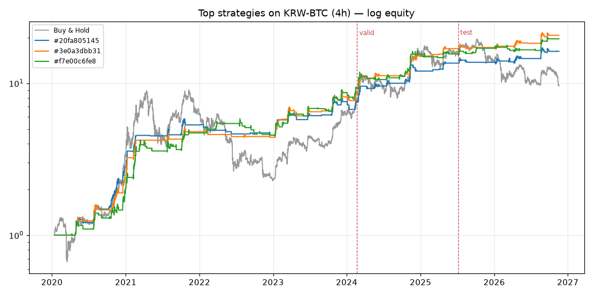

# 🤖 코인 전략 연구 리포트

마지막 업데이트: **2026-11-23** · 대상: KRW-BTC, KRW-ETH, KRW-XRP, KRW-SOL · 봉: 4h

## 🎓 졸업 심사

전당에 오른 뒤 **실제로 새로 쌓인 시세**로 매기는 시험이에요. 기준: 전진 60일 이상 · 그 기간에 +10% 넘는 상승장 포함 · 실제 거래 10회 이상(4코인 합) · 같은 기간 단순 보유보다 나은 수익 · 코인별 최대 낙폭 -20% 이내 · 튼튼함 심사 통과.

**졸업한 전략: 아직 없음**

졸업에 가장 가까운 전략:

| ID | 전진 기간 | 상승장 경험 | 실제 거래 | 보유 대비 | 최대 낙폭 | 튼튼함 | 통과 |
|---|---|---|---|---|---|---|---|
| `cdcac84052` | ⬜ 45일 | ⬜ 7% | ✅ 14회 | ✅ +30.9%p | ✅ -3% | ✅ 통과 | 4/6 |
| `fd1c453679` | ⬜ 44일 | ⬜ 7% | ✅ 10회 | ✅ +27.9%p | ✅ -7% | ✅ 통과 | 4/6 |
| `20fa805145` | ⬜ 46일 | ⬜ 7% | ⬜ 7회 | ✅ +32.9%p | ✅ -3% | ✅ 통과 | 3/6 |
| `f7e00c6fe8` | ⬜ 46일 | ⬜ 7% | ⬜ 0회 | ✅ +33.8%p | ✅ 0% | ✅ 통과 | 3/6 |
| `f00b4a37e3` | ⬜ 46일 | ⬜ 7% | ⬜ 0회 | ✅ +33.8%p | ✅ 0% | ✅ 통과 | 3/6 |
| `2439726ead` | ⬜ 46일 | ⬜ 7% | ⬜ 5회 | ✅ +30.2%p | ✅ -6% | ✅ 통과 | 3/6 |
| `b12dd3fbc7` | ⬜ 45일 | ⬜ 7% | ⬜ 1회 | ✅ +31.0%p | ✅ -6% | ✅ 통과 | 3/6 |
| `ae82267119` | ⬜ 45일 | ⬜ 7% | ⬜ 0회 | ✅ +31.3%p | ✅ 0% | ✅ 통과 | 3/6 |

## 📡 지금 보유 신호

전당 전략 45개 중 현재 코인을 들고 있는 전략: **없음 (모든 전략 관망 중)**

## 오늘
- 데이터: KRW-BTC, KRW-ETH, KRW-XRP, KRW-SOL · 4h · 마지막 봉 2026-11-22 12:00 UTC
- 542세대 진화, 전략 35,188개 평가
- 545세대 진화, 전략 65,743개 평가
- 튼튼함 심사: 10개 시도 → 3개 통과 (탈락 사유: 비용3배 7)
- 새로 명예의 전당 입성: 3개 (오늘 누적 3/3, 검증 구간 B&H 샤프 0.78)
- 퇴출: d8ae84ab14, 675084606c, 99beb77c71

## 명예의 전당

| # | ID | 발견일 | 학습 샤프 | 검증 샤프 | 시험 샤프 | 시험 CAGR | 시험 MDD | 전진 수익 / 같은 기간 보유 | 지금 | 전략 |
|---|---|---|---|---|---|---|---|---|---|---|
| 1 | `20fa805145` | 2026-10-08 | 1.87 | 2.03 | 0.85 | +13.1% | -18.9% | -0.9% / 보유 -33.8% (46일) | 관망 | 진입: macd_pos(f=16, s=21, sig=7) AND volume_spike(n=37, mult=3.51) | 청산: price_below_ma(n=55, kind=sma) OR ma_cross_down(fast=8, slow=102, kind=sma) | 익절 27.3% |
| 2 | `f7e00c6fe8` | 2026-10-08 | 1.87 | 1.91 | 1.18 | +22.3% | -22.0% | 관망 +0.0% / 보유 -33.8% (46일) | 관망 | 진입: donchian_break(n=71) AND price_above_ma(n=197, kind=sma) | 청산: price_below_ma(n=22, kind=ema) | 손절 19.1% / 익절 27.3% / 트레일링 24.5% |
| 3 | `3e0a3dbb31` | 2026-10-11 | 2.07 | 2.06 | 0.79 | +10.9% | -16.1% | -2.6% / 보유 -32.0% (43일) | 관망 | 진입: volume_spike(n=26, mult=3.63) AND momentum_pos(n=17, th=0.01) | 청산: price_below_ma(n=57, kind=sma) OR ma_cross_down(fast=5, slow=109, kind=sma) OR price_below_ma(n=135, kind=ema) | 익절 30.7% |
| 4 | `f00b4a37e3` | 2026-10-08 | 2.02 | 1.66 | 0.79 | +16.2% | -29.2% | 관망 +0.0% / 보유 -33.8% (46일) | 관망 | 진입: donchian_break(n=66) AND price_above_ma(n=197, kind=sma) AND volume_spike(n=44, mult=1.334) | 청산: price_below_ma(n=55, kind=sma) OR ma_cross_down(fast=8, slow=102, kind=sma) | 익절 27.3% |
| 5 | `cba03c6a1a` | 2026-10-09 | 1.77 | 2.29 | 0.65 | +12.5% | -19.4% | -2.3% / 보유 -32.2% (44일) | 관망 | 진입: macd_pos(f=16, s=21, sig=7) AND volume_spike(n=32, mult=3.51) | 청산: ma_cross_down(fast=8, slow=102, kind=sma) | 익절 27.3% |
| 6 | `7ba6000391` | 2026-10-09 | 1.78 | 1.94 | 0.90 | +19.1% | -15.6% | +0.4% / 보유 -32.2% (44일) | 관망 | 진입: donchian_break(n=26) | 청산: price_below_ma(n=15, kind=sma) OR ma_cross_down(fast=8, slow=102, kind=sma) | 익절 27.1% / 트레일링 21.4% |
| 7 | `ae82267119` | 2026-10-09 | 1.82 | 1.91 | 0.72 | +10.6% | -17.9% | 관망 +0.0% / 보유 -31.3% (45일) | 관망 | 진입: price_above_ma(n=169, kind=ema) AND volume_spike(n=35, mult=3.62) | 청산: price_below_ma(n=56, kind=sma) | 익절 38.6% |
| 8 | `cdcac84052` | 2026-10-09 | 1.77 | 1.96 | 0.41 | +8.5% | -21.9% | -1.6% / 보유 -32.6% (45일) | 관망 | 진입: price_above_ma(n=26, kind=ema) AND volume_spike(n=28, mult=2.52) | 청산: price_below_ma(n=55, kind=sma) OR ma_cross_down(fast=8, slow=99, kind=sma) | 손절 14.3% / 익절 27.3% / 트레일링 21.4% |
| 9 | `5ade91c3ae` | 2026-10-13 | 1.83 | 1.88 | 1.39 | +28.2% | -12.1% | 관망 +0.0% / 보유 -31.0% (41일) | 관망 | 진입: volume_spike(n=34, mult=3.53) AND donchian_break(n=83) | 청산: price_below_ma(n=139, kind=ema) OR donchian_low_break(n=18) | 손절 9.5% / 익절 32.2% |
| 10 | `114ad67d25` | 2026-10-11 | 1.96 | 1.89 | 0.42 | +8.0% | -27.4% | -2.6% / 보유 -32.0% (43일) | 관망 | 진입: volume_spike(n=20, mult=3.069) AND momentum_pos(n=17, th=0.01) | 청산: price_below_ma(n=142, kind=sma) OR ma_cross_down(fast=5, slow=109, kind=sma) OR price_below_ma(n=135, kind=ema) | 손절 20.4% / 익절 29.1% |
| 11 | `d7fb6c9904` | 2026-10-11 | 1.92 | 1.98 | 0.42 | +6.0% | -27.2% | -3.1% / 보유 -32.0% (43일) | 관망 | 진입: volume_spike(n=15, mult=2.369) AND momentum_pos(n=17, th=0.01) | 청산: price_below_ma(n=57, kind=sma) OR ma_cross_down(fast=5, slow=109, kind=sma) OR price_below_ma(n=135, kind=ema) | 익절 41.1% |
| 12 | `4f7cd897f0` | 2026-10-10 | 2.16 | 1.68 | 0.55 | +9.9% | -23.9% | -2.9% / 보유 -31.8% (44일) | 관망 | 진입: volume_spike(n=15, mult=3.025) AND momentum_pos(n=17, th=0.01) | 청산: price_below_ma(n=57, kind=sma) OR ma_cross_down(fast=5, slow=109, kind=sma) OR price_below_ma(n=135, kind=ema) | 손절 20.4% / 익절 29.1% |
| 13 | `fd1c453679` | 2026-10-10 | 1.98 | 1.94 | 0.63 | +13.5% | -23.3% | -3.5% / 보유 -31.4% (44일) | 관망 | 진입: volume_spike(n=20, mult=1.54) AND volume_spike(n=15, mult=2.715) AND price_above_ma(n=16, kind=sma) | 청산: price_below_ma(n=55, kind=sma) OR ma_cross_down(fast=8, slow=78, kind=sma) | 익절 27.3% |
| 14 | `030e70f004` | 2026-10-10 | 2.04 | 1.64 | 0.12 | +0.6% | -20.4% | -1.6% / 보유 -31.8% (43일) | 관망 | 진입: volume_spike(n=15, mult=3.025) AND momentum_pos(n=17, th=0.01) | 청산: price_below_ma(n=57, kind=sma) OR ma_cross_down(fast=47, slow=239, kind=sma) OR donchian_low_break(n=46) | 익절 29.1% |
| 15 | `2439726ead` | 2026-10-08 | 1.63 | 2.05 | 0.46 | +9.5% | -23.7% | -3.3% / 보유 -33.6% (46일) | 관망 | 진입: donchian_break(n=12) AND volume_spike(n=24, mult=2.89) | 청산: price_below_ma(n=116, kind=sma) |
| 16 | `ed518e2f80` | 2026-10-11 | 1.94 | 1.79 | 0.38 | +6.2% | -22.1% | -2.6% / 보유 -32.0% (43일) | 관망 | 진입: volume_spike(n=12, mult=3.069) AND momentum_pos(n=17, th=0.01) | 청산: ma_cross_down(fast=5, slow=108, kind=sma) OR price_below_ma(n=135, kind=ema) | 손절 20.4% / 익절 29.1% |
| 17 | `6f3685817a` | 2026-10-10 | 1.84 | 1.64 | 0.66 | +10.0% | -16.9% | 관망 +0.0% / 보유 -31.8% (43일) | 관망 | 진입: volume_spike(n=15, mult=3.025) AND momentum_pos(n=17, th=0.01) AND ma_cross_up(fast=13, slow=154, kind=sma) | 청산: price_below_ma(n=57, kind=sma) OR ma_cross_down(fast=5, slow=109, kind=sma) OR price_below_ma(n=135, kind=ema) | 익절 30.7% |
| 18 | `6335aeebf2` | 2026-10-10 | 1.92 | 1.84 | 0.40 | +6.6% | -23.9% | -2.9% / 보유 -31.8% (43일) | 관망 | 진입: volume_spike(n=15, mult=3.025) AND momentum_pos(n=17, th=0.01) | 청산: price_below_ma(n=57, kind=sma) OR ma_cross_down(fast=5, slow=109, kind=sma) OR price_below_ma(n=135, kind=ema) |
| 19 | `fa158e2ae7` | 2026-11-21 | 1.87 | 1.80 | 0.16 | -0.1% | -20.8% | 관망 +0.0% / 보유 +1.9% (2일) | 관망 | 진입: volume_spike(n=19, mult=3.625) AND price_above_ma(n=18, kind=sma) | 청산: bars_held(n=38) OR donchian_low_break(n=21) | 손절 29.2% / 익절 30.0% / 트레일링 26.3% |
| 20 | `43ba22956d` 🆕 | 2026-11-23 | 2.27 | 1.37 | 0.40 | +7.2% | -19.6% | - | - | 진입: macd_pos(f=3, s=29, sig=16) AND ma_cross_up(fast=36, slow=112, kind=ema) AND ma_cross_up(fast=5, slow=23, kind=ema) | 청산: donchian_low_break(n=9) OR rsi_above(n=25, th=79) OR bars_held(n=21) | 익절 30.4% |
| 21 | `b12dd3fbc7` | 2026-10-09 | 1.77 | 1.65 | 0.71 | +12.3% | -30.1% | -1.5% / 보유 -32.6% (45일) | 관망 | 진입: donchian_break(n=52) | 청산: price_below_ma(n=42, kind=sma) OR donchian_low_break(n=53) | 익절 33.6% |
| 22 | `4ca2bafdac` | 2026-10-27 | 1.44 | 2.45 | 0.81 | +12.3% | -18.9% | 관망 +0.0% / 보유 -25.8% (27일) | 관망 | 진입: donchian_break(n=86) OR drawdown_from_high(n=21, th=0.19) | 청산: donchian_low_break(n=27) OR price_below_ma(n=30, kind=ema) | 익절 6.2% |
| 23 | `848c7af378` | 2026-11-20 | 1.66 | 1.85 | 0.66 | +10.8% | -21.8% | 관망 +0.0% / 보유 -2.3% (2일) | 관망 | 진입: price_above_ma(n=76, kind=sma) AND macd_pos(f=7, s=26, sig=7) AND low_volatility(n=44, q=0.5) | 청산: price_below_ma(n=22, kind=ema) | 익절 28.0% / 트레일링 27.7% |
| 24 | `88b03c3bd9` | 2026-10-09 | 1.82 | 1.50 | 0.03 | -0.8% | -23.4% | -1.2% / 보유 -32.2% (44일) | 관망 | 진입: low_volatility(n=43, q=0.24) AND donchian_break(n=16) | 청산: price_below_ma(n=39, kind=ema) | 손절 12.0% / 익절 27.3% |
| 25 | `08a39b7267` | 2026-10-10 | 1.97 | 1.67 | 0.38 | +5.1% | -21.2% | -3.9% / 보유 -31.4% (44일) | 관망 | 진입: macd_pos(f=14, s=21, sig=7) AND volume_spike(n=29, mult=3.51) | 청산: price_below_ma(n=51, kind=sma) | 익절 60.8% |
| 26 | `84fcd77045` | 2026-10-12 | 1.40 | 1.89 | 0.44 | +4.5% | -12.2% | -1.3% / 보유 -32.1% (42일) | 관망 | 진입: volume_spike(n=15, mult=3.069) AND momentum_pos(n=17, th=0.01) AND volume_spike(n=10, mult=2.61) | 청산: bars_held(n=12) OR ma_cross_down(fast=6, slow=109, kind=sma) | 손절 28.0% / 익절 29.1% / 트레일링 28.7% |
| 27 | `c1fa33b98e` | 2026-11-21 | 1.75 | 1.65 | 1.02 | +15.2% | -17.5% | 관망 +0.0% / 보유 +1.9% (2일) | 관망 | 진입: volume_spike(n=26, mult=3.619) AND low_volatility(n=45, q=0.64) | 청산: price_below_ma(n=55, kind=sma) | 손절 22.7% / 익절 30.0% |
| 28 | `04479044b1` | 2026-11-17 | 1.67 | 1.64 | 1.22 | +15.7% | -10.1% | 관망 +0.0% / 보유 -3.7% (6일) | 관망 | 진입: donchian_break(n=76) AND volume_spike(n=56, mult=1.246) AND volume_spike(n=44, mult=3.57) | 청산: price_below_ma(n=53, kind=sma) | 손절 19.3% / 익절 13.9% / 트레일링 28.0% |
| 29 | `c2aebfdff3` | 2026-11-19 | 1.35 | 1.95 | 0.51 | +6.5% | -18.3% | 관망 +0.0% / 보유 -3.5% (4일) | 관망 | 진입: price_above_ma(n=117, kind=sma) AND volume_spike(n=11, mult=3.41) | 청산: price_below_ma(n=119, kind=sma) OR bars_held(n=39) | 손절 10.9% |
| 30 | `3504da9518` | 2026-11-20 | 1.18 | 2.12 | 1.23 | +18.0% | -12.0% | 관망 +0.0% / 보유 -3.0% (3일) | 관망 | 진입: donchian_break(n=90) AND volume_spike(n=55, mult=3.84) | 청산: bars_held(n=40) | 손절 4.6% |
| 31 | `51e55b9c84` | 2026-10-26 | 1.51 | 2.07 | 1.75 | +20.4% | -6.6% | 관망 +0.0% / 보유 -26.4% (28일) | 관망 | 진입: volume_spike(n=14, mult=3.68) AND donchian_break(n=51) | 청산: bars_held(n=35) | 손절 12.9% / 익절 40.4% / 트레일링 26.8% |
| 32 | `52be14e05e` | 2026-11-17 | 1.62 | 1.65 | 0.70 | +14.4% | -23.1% | 관망 +0.0% / 보유 -4.1% (6일) | 관망 | 진입: volume_spike(n=30, mult=2.42) AND low_volatility(n=36, q=0.26) | 청산: price_below_ma(n=29, kind=ema) | 손절 17.1% |
| 33 | `3ec1452b69` | 2026-11-21 | 1.78 | 1.44 | 0.89 | +18.0% | -21.2% | 관망 +0.0% / 보유 +1.9% (2일) | 관망 | 진입: low_volatility(n=36, q=0.56) AND momentum_pos(n=17, th=0.008) AND volume_spike(n=10, mult=2.599) | 청산: price_below_ma(n=58, kind=sma) OR ma_cross_down(fast=6, slow=107, kind=sma) OR price_below_ma(n=135, kind=ema) | 손절 21.3% / 익절 29.1% |
| 34 | `4414a03b38` | 2026-11-19 | 1.57 | 1.65 | 0.18 | +1.8% | -23.8% | 관망 +0.0% / 보유 -3.5% (4일) | 관망 | 진입: volume_spike(n=57, mult=3.68) AND macd_pos(f=10, s=50, sig=6) | 청산: ma_cross_down(fast=20, slow=88, kind=ema) | 트레일링 10.0% |
| 35 | `5b8f9bc24f` | 2026-11-18 | 1.30 | 1.90 | 0.69 | +12.7% | -16.0% | 관망 +0.0% / 보유 -4.8% (4일) | 관망 | 진입: donchian_break(n=90) OR drawdown_from_high(n=23, th=0.168) | 청산: price_below_ma(n=18, kind=sma) OR bars_held(n=38) |
| 36 | `44f7a03cc5` | 2026-11-17 | 1.71 | 1.48 | 1.08 | +17.5% | -16.5% | 관망 +0.0% / 보유 -3.7% (6일) | 관망 | 진입: volume_spike(n=15, mult=3.025) AND momentum_pos(n=14, th=0.014) AND low_volatility(n=33, q=0.29) | 청산: price_below_ma(n=55, kind=sma) OR ma_cross_down(fast=5, slow=109, kind=sma) OR price_below_ma(n=135, kind=ema) | 손절 20.4% / 익절 29.1% |
| 37 | `efc7382834` 🆕 | 2026-11-23 | 1.59 | 1.56 | 1.05 | +20.4% | -14.6% | - | - | 진입: low_volatility(n=31, q=0.43) AND donchian_break(n=30) AND ma_cross_up(fast=23, slow=138, kind=sma) | 청산: price_below_ma(n=70, kind=sma) OR price_below_ma(n=33, kind=ema) | 트레일링 27.4% |
| 38 | `1c5674c6d8` | 2026-11-19 | 1.63 | 1.52 | 0.73 | +15.2% | -15.0% | 관망 +0.0% / 보유 -3.5% (4일) | 관망 | 진입: donchian_break(n=36) AND low_volatility(n=17, q=0.55) | 청산: price_below_ma(n=22, kind=ema) |
| 39 | `f1611a53cb` 🆕 | 2026-11-23 | 1.52 | 1.59 | -0.06 | -3.3% | -31.1% | - | - | 진입: macd_pos(f=3, s=29, sig=15) AND volume_spike(n=10, mult=1.78) | 청산: price_below_ma(n=16, kind=sma) OR rsi_above(n=25, th=79) | 익절 25.6% |
| 40 | `a9462e61b4` | 2026-11-16 | 1.37 | 1.73 | 0.83 | +16.9% | -20.4% | 관망 +0.0% / 보유 -5.4% (7일) | 관망 | 진입: low_volatility(n=33, q=0.28) AND volume_spike(n=38, mult=2.95) | 청산: price_below_ma(n=33, kind=sma) | 손절 8.0% / 익절 41.0% / 트레일링 29.2% |
| 41 | `88108241f6` | 2026-11-22 | 1.66 | 1.34 | 1.03 | +22.0% | -20.3% | 관망 +0.0% / 보유 -0.0% (1일) | 관망 | 진입: donchian_break(n=27) AND low_volatility(n=59, q=0.29) | 청산: ma_cross_down(fast=39, slow=61, kind=ema) OR price_below_ma(n=54, kind=sma) | 손절 16.0% / 익절 52.7% |
| 42 | `4d4d21ab4f` | 2026-11-22 | 1.22 | 1.67 | 1.19 | +24.3% | -16.5% | 관망 +0.0% / 보유 -0.0% (1일) | 관망 | 진입: donchian_break(n=86) AND volume_spike(n=53, mult=2.4) | 청산: donchian_low_break(n=23) | 손절 3.9% / 익절 29.7% / 트레일링 19.1% |
| 43 | `427e33e785` | 2026-11-22 | 1.46 | 1.43 | 0.87 | +18.0% | -26.5% | 관망 +0.0% / 보유 -0.0% (1일) | 관망 | 진입: volume_spike(n=37, mult=2.16) AND macd_pos(f=7, s=44, sig=15) | 청산: bars_held(n=20) OR price_below_ma(n=22, kind=sma) | 익절 7.9% / 트레일링 17.2% |
| 44 | `600be275ef` | 2026-11-15 | 1.98 | 1.72 | 0.47 | +7.5% | -20.6% | 관망 +0.0% / 보유 -6.6% (8일) | 관망 | 진입: donchian_break(n=18) AND ma_cross_up(fast=3, slow=205, kind=ema) AND low_volatility(n=33, q=0.5) | 청산: price_below_ma(n=16, kind=sma) OR bars_held(n=49) | 손절 19.1% / 익절 59.3% / 트레일링 38.5% |
| 45 | `d6558d3b8c` | 2026-11-14 | 1.44 | 2.08 | 0.64 | +11.0% | -17.6% | 관망 +0.0% / 보유 -8.2% (8일) | 관망 | 진입: momentum_pos(n=78, th=0.049) AND volume_spike(n=52, mult=3.98) | 청산: ma_cross_down(fast=15, slow=99, kind=sma) OR bars_held(n=43) | 손절 6.8% / 익절 28.9% |

비교 기준(단순 보유) 샤프 — 학습 0.93 · 검증 0.78 · 시험 -1.00

📖 규칙 설명

**데이터 나누기** — 과거 시세를 학습(앞 60%) · 검증(다음 20%) · 시험(마지막 20%)으로 나눠요. 전략은 학습 구간 성적으로만 진화하고, 검증 구간으로 입성을 심사해요. 시험 구간은 참고로 보여주기만 해요.

**입성 심사** — ① 검증 구간 샤프가 단순 보유보다 0.5 이상 높을 것 ② 기존 전당 전략과 수익 흐름이 비슷하지 않을 것(상관 0.7 이하) ③ 튼튼함 심사: 숫자 파라미터를 ±15% 흔든 변형 6개도 대체로 좋을 것, 거래 비용이 3배여도 단순 보유보다 나을 것, 4개 코인 중 3개 이상에서 단순 보유보다 나을 것. 하루 최대 3개.

**자리 관리** — 전당은 45자리. 입성 후 42봉(7일) 동안은 보호돼요. 자리가 차면, 보호 기간이 끝난 전략과 신입 중 점수가 가장 낮은 것이 나가요. 보호 기간 뒤 낙폭이 -35%보다 나빠지면 퇴출돼요.

**점수** — 학습·검증 샤프 평균에, 보호 기간이 끝난 전략은 '같은 기간 단순 보유 대비 초과 수익'을 더해요. 하락장에서 현금으로 피한 것도 실력으로 인정돼요.

**체결 가정** — 봉 마감 신호 → 다음 봉 시가 체결, 수수료 0.05% + 슬리피지 0.05%(한쪽), 같은 봉에서 손절·익절이 둘 다 닿으면 손절로 처리. 샤프·CAGR·MDD는 4개 코인의 중앙값.

백테스트와 졸업은 미래 수익을 보장하지 않습니다. 이 리포트는 투자 권유가 아니에요.