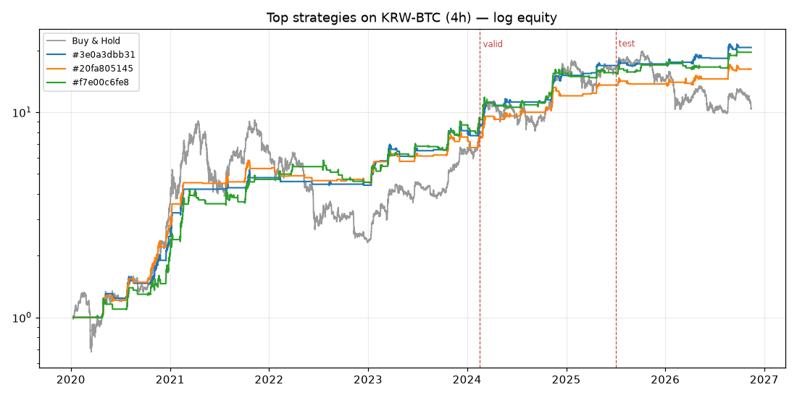

# 🤖 코인 전략 연구 리포트

마지막 업데이트: **2026-11-05** · 대상: KRW-BTC, KRW-ETH, KRW-XRP, KRW-SOL · 봉: 4h

## 🎓 졸업 심사

전당에 오른 뒤 **실제로 새로 쌓인 시세**로 매기는 시험이에요. 기준: 전진 60일 이상 · 그 기간에 +10% 넘는 상승장 포함 · 실제 거래 10회 이상(4코인 합) · 같은 기간 단순 보유보다 나은 수익 · 코인별 최대 낙폭 -20% 이내 · 튼튼함 심사 통과.

**졸업한 전략: 아직 없음**

졸업에 가장 가까운 전략:

| ID | 전진 기간 | 상승장 경험 | 실제 거래 | 보유 대비 | 최대 낙폭 | 튼튼함 | 통과 |
|---|---|---|---|---|---|---|---|
| `cdcac84052` | ⬜ 27일 | ⬜ 6% | ✅ 10회 | ✅ +8.0%p | ✅ -2% | ✅ 통과 | 4/6 |
| `f7e00c6fe8` | ⬜ 28일 | ⬜ 6% | ⬜ 0회 | ✅ +10.3%p | ✅ 0% | ✅ 통과 | 3/6 |
| `20fa805145` | ⬜ 28일 | ⬜ 6% | ⬜ 1회 | ✅ +10.1%p | ✅ 0% | ✅ 통과 | 3/6 |
| `f00b4a37e3` | ⬜ 28일 | ⬜ 6% | ⬜ 0회 | ✅ +10.3%p | ✅ 0% | ✅ 통과 | 3/6 |
| `2439726ead` | ⬜ 28일 | ⬜ 6% | ⬜ 1회 | ✅ +9.8%p | ✅ -1% | ✅ 통과 | 3/6 |
| `b12dd3fbc7` | ⬜ 27일 | ⬜ 6% | ⬜ 0회 | ✅ +8.5%p | ✅ 0% | ✅ 통과 | 3/6 |
| `ae82267119` | ⬜ 27일 | ⬜ 6% | ⬜ 0회 | ✅ +6.9%p | ✅ 0% | ✅ 통과 | 3/6 |
| `cba03c6a1a` | ⬜ 26일 | ⬜ 6% | ⬜ 2회 | ✅ +8.0%p | ✅ 0% | ✅ 통과 | 3/6 |

## 📡 지금 보유 신호

전당 전략 45개 중 현재 코인을 들고 있는 전략: **ETH 1개 · XRP 1개**

## 오늘
- 데이터: KRW-BTC, KRW-ETH, KRW-XRP, KRW-SOL · 4h · 마지막 봉 2026-11-04 12:00 UTC
- 1447세대 진화, 전략 69,888개 평가
- 튼튼함 심사: 4개 시도 → 3개 통과 (탈락 사유: 비용3배 1)
- 새로 명예의 전당 입성: 1개 (오늘 누적 1/3, 검증 구간 B&H 샤프 1.05)
- 퇴출: 1e25bada5a

## 명예의 전당

| # | ID | 발견일 | 학습 샤프 | 검증 샤프 | 시험 샤프 | 시험 CAGR | 시험 MDD | 전진 수익 / 같은 기간 보유 | 지금 | 전략 |
|---|---|---|---|---|---|---|---|---|---|---|
| 1 | `3e0a3dbb31` | 2026-10-11 | 2.09 | 2.24 | 0.94 | +13.9% | -16.1% | -0.3% / 보유 -7.8% (25일) | 관망 | 진입: volume_spike(n=26, mult=3.63) AND momentum_pos(n=17, th=0.01) | 청산: price_below_ma(n=57, kind=sma) OR ma_cross_down(fast=5, slow=109, kind=sma) OR price_below_ma(n=135, kind=ema) | 익절 30.7% |
| 2 | `f7e00c6fe8` | 2026-10-08 | 1.88 | 2.11 | 1.20 | +22.4% | -22.0% | 관망 +0.0% / 보유 -10.3% (28일) | 관망 | 진입: donchian_break(n=71) AND price_above_ma(n=197, kind=sma) | 청산: price_below_ma(n=22, kind=ema) | 손절 19.1% / 익절 27.3% / 트레일링 24.5% |
| 3 | `20fa805145` | 2026-10-08 | 1.85 | 2.15 | 0.93 | +14.5% | -18.9% | -0.1% / 보유 -10.3% (28일) | 관망 | 진입: macd_pos(f=16, s=21, sig=7) AND volume_spike(n=37, mult=3.51) | 청산: price_below_ma(n=55, kind=sma) OR ma_cross_down(fast=8, slow=102, kind=sma) | 익절 27.3% |
| 4 | `cba03c6a1a` | 2026-10-09 | 1.71 | 2.42 | 0.80 | +15.1% | -19.4% | -0.0% / 보유 -8.0% (26일) | 관망 | 진입: macd_pos(f=16, s=21, sig=7) AND volume_spike(n=32, mult=3.51) | 청산: ma_cross_down(fast=8, slow=102, kind=sma) | 익절 27.3% |
| 5 | `f00b4a37e3` | 2026-10-08 | 2.03 | 1.82 | 0.88 | +15.9% | -29.2% | 관망 +0.0% / 보유 -10.3% (28일) | 관망 | 진입: donchian_break(n=66) AND price_above_ma(n=197, kind=sma) AND volume_spike(n=44, mult=1.334) | 청산: price_below_ma(n=55, kind=sma) OR ma_cross_down(fast=8, slow=102, kind=sma) | 익절 27.3% |
| 6 | `114ad67d25` | 2026-10-11 | 1.98 | 2.10 | 0.55 | +11.4% | -27.4% | -0.3% / 보유 -7.8% (25일) | 관망 | 진입: volume_spike(n=20, mult=3.069) AND momentum_pos(n=17, th=0.01) | 청산: price_below_ma(n=142, kind=sma) OR ma_cross_down(fast=5, slow=109, kind=sma) OR price_below_ma(n=135, kind=ema) | 손절 20.4% / 익절 29.1% |
| 7 | `2439726ead` | 2026-10-08 | 1.71 | 2.13 | 0.70 | +14.0% | -23.7% | -0.2% / 보유 -9.9% (28일) | 관망 | 진입: donchian_break(n=12) AND volume_spike(n=24, mult=2.89) | 청산: price_below_ma(n=116, kind=sma) |
| 8 | `7ba6000391` | 2026-10-09 | 1.76 | 2.09 | 0.87 | +18.5% | -15.6% | +0.8% / 보유 -8.0% (26일) | ETH | 진입: donchian_break(n=26) | 청산: price_below_ma(n=15, kind=sma) OR ma_cross_down(fast=8, slow=102, kind=sma) | 익절 27.1% / 트레일링 21.4% |
| 9 | `fd1c453679` | 2026-10-10 | 1.99 | 2.04 | 0.80 | +17.7% | -23.3% | -0.4% / 보유 -6.9% (26일) | 관망 | 진입: volume_spike(n=20, mult=1.54) AND volume_spike(n=15, mult=2.715) AND price_above_ma(n=16, kind=sma) | 청산: price_below_ma(n=55, kind=sma) OR ma_cross_down(fast=8, slow=78, kind=sma) | 익절 27.3% |
| 10 | `d7fb6c9904` | 2026-10-11 | 1.97 | 2.00 | 0.52 | +7.8% | -27.2% | -0.7% / 보유 -7.8% (25일) | 관망 | 진입: volume_spike(n=15, mult=2.369) AND momentum_pos(n=17, th=0.01) | 청산: price_below_ma(n=57, kind=sma) OR ma_cross_down(fast=5, slow=109, kind=sma) OR price_below_ma(n=135, kind=ema) | 익절 41.1% |
| 11 | `cdcac84052` | 2026-10-09 | 1.72 | 2.14 | 0.48 | +10.3% | -21.9% | -0.5% / 보유 -8.5% (27일) | 관망 | 진입: price_above_ma(n=26, kind=ema) AND volume_spike(n=28, mult=2.52) | 청산: price_below_ma(n=55, kind=sma) OR ma_cross_down(fast=8, slow=99, kind=sma) | 손절 14.3% / 익절 27.3% / 트레일링 21.4% |
| 12 | `ae82267119` | 2026-10-09 | 1.76 | 2.20 | 0.72 | +11.1% | -17.9% | 관망 +0.0% / 보유 -6.9% (27일) | 관망 | 진입: price_above_ma(n=169, kind=ema) AND volume_spike(n=35, mult=3.62) | 청산: price_below_ma(n=56, kind=sma) | 익절 38.6% |
| 13 | `6335aeebf2` | 2026-10-10 | 2.04 | 1.92 | 0.55 | +10.2% | -23.9% | -0.6% / 보유 -7.5% (25일) | 관망 | 진입: volume_spike(n=15, mult=3.025) AND momentum_pos(n=17, th=0.01) | 청산: price_below_ma(n=57, kind=sma) OR ma_cross_down(fast=5, slow=109, kind=sma) OR price_below_ma(n=135, kind=ema) |
| 14 | `ed518e2f80` | 2026-10-11 | 2.09 | 1.81 | 0.53 | +9.7% | -22.1% | -0.6% / 보유 -7.8% (25일) | 관망 | 진입: volume_spike(n=12, mult=3.069) AND momentum_pos(n=17, th=0.01) | 청산: ma_cross_down(fast=5, slow=108, kind=sma) OR price_below_ma(n=135, kind=ema) | 손절 20.4% / 익절 29.1% |
| 15 | `4f7cd897f0` | 2026-10-10 | 2.25 | 1.65 | 0.70 | +13.3% | -23.9% | -0.6% / 보유 -7.5% (26일) | 관망 | 진입: volume_spike(n=15, mult=3.025) AND momentum_pos(n=17, th=0.01) | 청산: price_below_ma(n=57, kind=sma) OR ma_cross_down(fast=5, slow=109, kind=sma) OR price_below_ma(n=135, kind=ema) | 손절 20.4% / 익절 29.1% |
| 16 | `030e70f004` | 2026-10-10 | 2.09 | 1.81 | 0.19 | +1.9% | -20.4% | -0.6% / 보유 -7.5% (25일) | 관망 | 진입: volume_spike(n=15, mult=3.025) AND momentum_pos(n=17, th=0.01) | 청산: price_below_ma(n=57, kind=sma) OR ma_cross_down(fast=47, slow=239, kind=sma) OR donchian_low_break(n=46) | 익절 29.1% |
| 17 | `88b03c3bd9` | 2026-10-09 | 1.83 | 1.94 | 0.04 | -0.7% | -23.4% | -1.2% / 보유 -8.0% (26일) | 관망 | 진입: low_volatility(n=43, q=0.24) AND donchian_break(n=16) | 청산: price_below_ma(n=39, kind=ema) | 손절 12.0% / 익절 27.3% |
| 18 | `b12dd3fbc7` | 2026-10-09 | 1.72 | 1.83 | 0.80 | +15.8% | -30.1% | 관망 +0.0% / 보유 -8.5% (27일) | 관망 | 진입: donchian_break(n=52) | 청산: price_below_ma(n=42, kind=sma) OR donchian_low_break(n=53) | 익절 33.6% |
| 19 | `6f3685817a` | 2026-10-10 | 2.01 | 1.65 | 0.67 | +11.5% | -16.9% | 관망 +0.0% / 보유 -7.5% (25일) | 관망 | 진입: volume_spike(n=15, mult=3.025) AND momentum_pos(n=17, th=0.01) AND ma_cross_up(fast=13, slow=154, kind=sma) | 청산: price_below_ma(n=57, kind=sma) OR ma_cross_down(fast=5, slow=109, kind=sma) OR price_below_ma(n=135, kind=ema) | 익절 30.7% |
| 20 | `08a39b7267` | 2026-10-10 | 1.93 | 1.80 | 0.57 | +7.3% | -21.2% | -0.7% / 보유 -6.9% (26일) | 관망 | 진입: macd_pos(f=14, s=21, sig=7) AND volume_spike(n=29, mult=3.51) | 청산: price_below_ma(n=51, kind=sma) | 익절 60.8% |
| 21 | `5ade91c3ae` | 2026-10-13 | 1.78 | 1.84 | 1.47 | +30.2% | -12.1% | 관망 +0.0% / 보유 -6.4% (23일) | 관망 | 진입: volume_spike(n=34, mult=3.53) AND donchian_break(n=83) | 청산: price_below_ma(n=139, kind=ema) OR donchian_low_break(n=18) | 손절 9.5% / 익절 32.2% |
| 22 | `d64bf6417c` | 2026-10-11 | 1.64 | 1.81 | 0.25 | +7.1% | -28.4% | 관망 +0.0% / 보유 -7.0% (24일) | 관망 | 진입: ma_cross_up(fast=38, slow=189, kind=sma) AND donchian_break(n=31) | 청산: bars_held(n=48) | 손절 10.4% / 익절 18.0% |
| 23 | `4ca2bafdac` | 2026-10-27 | 1.40 | 2.81 | 0.84 | +13.5% | -18.9% | 관망 +0.0% / 보유 +0.7% (9일) | 관망 | 진입: donchian_break(n=86) OR drawdown_from_high(n=21, th=0.19) | 청산: donchian_low_break(n=27) OR price_below_ma(n=30, kind=ema) | 익절 6.2% |
| 24 | `84fcd77045` | 2026-10-12 | 1.41 | 1.92 | 0.52 | +5.2% | -12.2% | -0.3% / 보유 -8.0% (24일) | 관망 | 진입: volume_spike(n=15, mult=3.069) AND momentum_pos(n=17, th=0.01) AND volume_spike(n=10, mult=2.61) | 청산: bars_held(n=12) OR ma_cross_down(fast=6, slow=109, kind=sma) | 손절 28.0% / 익절 29.1% / 트레일링 28.7% |
| 25 | `984a3db347` | 2026-10-21 | 1.30 | 2.15 | 0.96 | +15.0% | -14.2% | 관망 +0.0% / 보유 -3.9% (14일) | 관망 | 진입: volume_spike(n=53, mult=3.87) AND price_above_ma(n=196, kind=sma) | 청산: price_below_ma(n=62, kind=sma) | 손절 3.8% / 익절 12.8% |
| 26 | `a0dbda8ff5` | 2026-10-11 | 1.49 | 1.65 | 0.85 | +12.2% | -13.0% | 관망 +0.0% / 보유 -7.0% (24일) | 관망 | 진입: donchian_break(n=78) AND low_volatility(n=48, q=0.45) | 청산: price_below_ma(n=16, kind=sma) | 손절 17.2% / 익절 18.6% |
| 27 | `9b8b1a5627` | 2026-10-13 | 1.36 | 1.83 | 0.88 | +17.7% | -15.5% | 관망 +0.0% / 보유 -6.4% (23일) | 관망 | 진입: volume_spike(n=43, mult=3.25) AND ma_cross_up(fast=6, slow=196, kind=sma) AND donchian_break(n=32) | 청산: price_below_ma(n=45, kind=ema) | 트레일링 11.9% |
| 28 | `2019d37dc0` | 2026-10-16 | 1.54 | 1.87 | 0.19 | +1.8% | -17.7% | 관망 +0.0% / 보유 -4.1% (20일) | 관망 | 진입: volume_spike(n=29, mult=3.93) AND ma_cross_up(fast=46, slow=140, kind=ema) | 청산: ma_cross_down(fast=43, slow=53, kind=sma) | 익절 30.9% |
| 29 | `f25d57d3ab` | 2026-10-11 | 1.57 | 1.54 | 1.12 | +20.0% | -18.8% | -0.2% / 보유 -7.0% (24일) | 관망 | 진입: volume_spike(n=20, mult=3.064) AND momentum_pos(n=17, th=0.01) AND low_volatility(n=53, q=0.37) | 청산: price_below_ma(n=57, kind=sma) OR ma_cross_down(fast=5, slow=109, kind=sma) OR price_below_ma(n=135, kind=ema) | 익절 29.1% / 트레일링 27.2% |
| 30 | `7746daa9c2` | 2026-10-12 | 1.55 | 1.56 | 0.67 | +18.3% | -20.9% | -1.3% / 보유 -8.0% (24일) | 관망 | 진입: low_volatility(n=33, q=0.28) AND volume_spike(n=22, mult=2.3) | 청산: price_below_ma(n=64, kind=ema) OR donchian_low_break(n=38) |
| 31 | `ca973a05b7` | 2026-10-22 | 1.34 | 1.93 | 1.00 | +16.1% | -10.5% | 관망 +0.0% / 보유 -5.1% (14일) | 관망 | 진입: volume_spike(n=54, mult=3.29) AND ma_cross_up(fast=5, slow=149, kind=sma) AND macd_pos(f=11, s=37, sig=7) | 청산: price_below_ma(n=122, kind=ema) OR price_below_ma(n=27, kind=ema) | 손절 19.8% / 익절 9.1% |
| 32 | `0159cf6bdc` | 2026-10-15 | 1.68 | 1.73 | 0.84 | +14.6% | -20.7% | -0.3% / 보유 -3.7% (21일) | 관망 | 진입: volume_spike(n=29, mult=3.02) AND macd_pos(f=14, s=57, sig=10) AND donchian_break(n=16) | 청산: ma_cross_down(fast=6, slow=123, kind=sma) | 손절 15.2% / 익절 9.6% |
| 33 | `0157ce73c1` | 2026-11-03 | 1.58 | 2.16 | 0.35 | +3.4% | -14.0% | 관망 +0.0% / 보유 +5.0% (2일) | 관망 | 진입: ma_cross_up(fast=25, slow=152, kind=sma) AND macd_pos(f=6, s=46, sig=10) AND volume_spike(n=32, mult=3.56) | 청산: price_below_ma(n=50, kind=ema) OR price_below_ma(n=130, kind=ema) | 익절 10.9% |
| 34 | `6e5115a679` | 2026-10-12 | 1.43 | 1.57 | 0.08 | -0.1% | -25.4% | -0.8% / 보유 -8.0% (24일) | 관망 | 진입: volume_spike(n=53, mult=2.5) AND donchian_break(n=30) AND macd_pos(f=8, s=21, sig=10) | 청산: ma_cross_down(fast=44, slow=176, kind=ema) | 익절 44.7% / 트레일링 9.8% |
| 35 | `b653d79769` | 2026-10-16 | 1.48 | 1.75 | -0.19 | -4.6% | -32.7% | 관망 +0.0% / 보유 -4.1% (20일) | 관망 | 진입: donchian_break(n=17) AND momentum_pos(n=85, th=0.033) | 청산: donchian_low_break(n=33) | 손절 2.4% / 익절 38.5% |
| 36 | `d4284520e1` 🆕 | 2026-11-05 | 1.41 | 2.23 | 0.53 | +5.8% | -14.0% | - | - | 진입: ma_cross_up(fast=37, slow=174, kind=ema) AND volume_spike(n=60, mult=3.85) AND macd_pos(f=10, s=42, sig=12) | 청산: bars_held(n=35) |
| 37 | `8db4842432` | 2026-10-17 | 1.53 | 1.84 | 0.01 | -5.0% | -37.9% | 관망 +0.0% / 보유 -2.6% (19일) | 관망 | 진입: momentum_pos(n=74, th=0.087) | 청산: bars_held(n=48) | 익절 10.1% |
| 38 | `51e55b9c84` | 2026-10-26 | 1.51 | 2.09 | 1.75 | +20.5% | -6.6% | 관망 +0.0% / 보유 -0.1% (10일) | 관망 | 진입: volume_spike(n=14, mult=3.68) AND donchian_break(n=51) | 청산: bars_held(n=35) | 손절 12.9% / 익절 40.4% / 트레일링 26.8% |
| 39 | `9956c655a7` | 2026-10-18 | 1.63 | 1.69 | 1.09 | +22.1% | -20.0% | 관망 +0.0% / 보유 -2.8% (18일) | 관망 | 진입: donchian_break(n=49) AND volume_spike(n=59, mult=2.83) | 청산: price_below_ma(n=121, kind=ema) | 손절 8.9% / 익절 32.0% |
| 40 | `1af1a925d9` | 2026-10-23 | 1.62 | 1.84 | 1.07 | +19.4% | -19.4% | -0.4% / 보유 -1.9% (12일) | XRP | 진입: low_volatility(n=22, q=0.41) AND donchian_break(n=27) | 청산: price_below_ma(n=32, kind=sma) | 손절 5.5% / 익절 34.9% |
| 41 | `90e3707031` | 2026-10-24 | 1.66 | 1.73 | 0.44 | +6.6% | -26.4% | 관망 +0.0% / 보유 -1.8% (12일) | 관망 | 진입: ma_cross_up(fast=25, slow=145, kind=ema) AND donchian_break(n=12) | 청산: ma_cross_down(fast=3, slow=140, kind=sma) OR bars_held(n=18) | 손절 18.3% / 익절 32.3% |
| 42 | `b390e7f743` | 2026-10-21 | 1.32 | 1.94 | 0.47 | +5.5% | -22.6% | 관망 +0.0% / 보유 -2.6% (15일) | 관망 | 진입: volume_spike(n=29, mult=3.8) AND price_above_ma(n=88, kind=sma) | 청산: rsi_above(n=23, th=82) OR price_below_ma(n=121, kind=sma) | 손절 8.7% / 익절 45.8% / 트레일링 12.7% |
| 43 | `ee83207716` | 2026-10-25 | 1.82 | 1.86 | 0.66 | +11.0% | -20.0% | -0.5% / 보유 +1.2% (11일) | 관망 | 진입: low_volatility(n=22, q=0.63) AND momentum_pos(n=18, th=0.015) AND volume_spike(n=10, mult=2.598) | 청산: price_below_ma(n=58, kind=sma) OR ma_cross_down(fast=6, slow=108, kind=sma) OR price_below_ma(n=135, kind=ema) | 익절 29.1% / 트레일링 53.1% |
| 44 | `98920b3d94` | 2026-10-23 | 1.47 | 1.82 | 0.85 | +15.4% | -21.1% | -0.9% / 보유 -1.4% (13일) | 관망 | 진입: low_volatility(n=44, q=0.54) AND momentum_pos(n=17, th=0.01) AND volume_spike(n=33, mult=1.68) | 청산: price_below_ma(n=57, kind=sma) OR ma_cross_down(fast=5, slow=109, kind=sma) OR price_below_ma(n=135, kind=ema) | 익절 30.7% |
| 45 | `66d37edf20` | 2026-10-24 | 1.70 | 1.59 | 1.42 | +26.7% | -22.7% | -1.4% / 보유 -1.8% (12일) | 관망 | 진입: donchian_break(n=27) AND low_volatility(n=54, q=0.47) | 청산: price_below_ma(n=18, kind=ema) |

비교 기준(단순 보유) 샤프 — 학습 0.96 · 검증 1.05 · 시험 -0.30

📖 규칙 설명

**데이터 나누기** — 과거 시세를 학습(앞 60%) · 검증(다음 20%) · 시험(마지막 20%)으로 나눠요. 전략은 학습 구간 성적으로만 진화하고, 검증 구간으로 입성을 심사해요. 시험 구간은 참고로 보여주기만 해요.

**입성 심사** — ① 검증 구간 샤프가 단순 보유보다 0.5 이상 높을 것 ② 기존 전당 전략과 수익 흐름이 비슷하지 않을 것(상관 0.7 이하) ③ 튼튼함 심사: 숫자 파라미터를 ±15% 흔든 변형 6개도 대체로 좋을 것, 거래 비용이 3배여도 단순 보유보다 나을 것, 4개 코인 중 3개 이상에서 단순 보유보다 나을 것. 하루 최대 3개.

**자리 관리** — 전당은 45자리. 입성 후 42봉(7일) 동안은 보호돼요. 자리가 차면, 보호 기간이 끝난 전략과 신입 중 점수가 가장 낮은 것이 나가요. 보호 기간 뒤 낙폭이 -35%보다 나빠지면 퇴출돼요.

**점수** — 학습·검증 샤프 평균에, 보호 기간이 끝난 전략은 '같은 기간 단순 보유 대비 초과 수익'을 더해요. 하락장에서 현금으로 피한 것도 실력으로 인정돼요.

**체결 가정** — 봉 마감 신호 → 다음 봉 시가 체결, 수수료 0.05% + 슬리피지 0.05%(한쪽), 같은 봉에서 손절·익절이 둘 다 닿으면 손절로 처리. 샤프·CAGR·MDD는 4개 코인의 중앙값.

백테스트와 졸업은 미래 수익을 보장하지 않습니다. 이 리포트는 투자 권유가 아니에요.